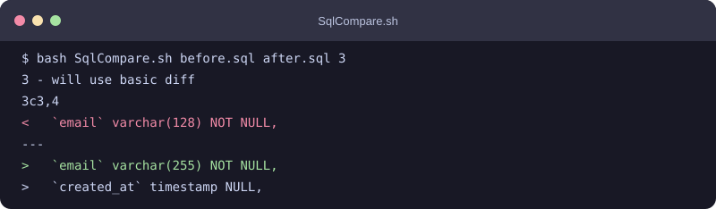

# MySQL Schema Diff

[](https://github.com/alsd4git/mysql-schema-diff/actions/workflows/ci.yml)
[](LICENSE)

Normalize and compare two MySQL `CREATE TABLE` dumps from the command line.

The script removes lines that start with `/*` or `-- `, blank lines, lines
starting with two spaces and `CONSTRAINT`, and text from ` COMMENT` onward on a
column line. It replaces any line containing `ENGINE=` with `);` before sending
the normalized files to `diff`, `icdiff`, or Meld. It does not connect to MySQL
or modify the input files.

## Requirements

- Bash
- `awk`, `cmp`, `diff`, and `mktemp`
- optional: `icdiff` or Meld for the corresponding output mode

The script works in a regular Linux or macOS Bash environment and in Git Bash
on Windows.

## Usage

```bash
git clone https://github.com/alsd4git/mysql-schema-diff.git
cd mysql-schema-diff
./SqlCompare.sh old-schema.sql new-schema.sql MODE
```

`MODE` selects the comparison program and defaults to `3`. Run
`./SqlCompare.sh -h` or `--help` for the command syntax. Both input paths are
required. Absolute paths, spaces and filenames beginning with `-` are supported.

| Mode | Output |
| --- | --- |
| `1` | colored terminal output through `icdiff` |
| `2` | `meld` on PATH, or Windows Meld under `Program Files (x86)` in Git Bash |
| `3` | standard `diff`, with color when supported |
| `4` | side-by-side `diff`, with color when supported |

Terminal output is non-interactive. Meld runs in the foreground; temporary
inputs are kept until its command exits. Modes `1` and `2` require
their optional tool even if the normalized files turn out to be equal.

Exit codes are `0` for equal normalized schemas, `1` for differences and `2` for
invalid input, missing tools or command failures. GUI mode also returns `1` when
the inputs differ; it does not use edits made inside Meld to redefine equality.

## Example

```bash
cat > before.sql <<'SQL'
CREATE TABLE `accounts` (
  `id` int NOT NULL,
  `email` varchar(128) NOT NULL,
  PRIMARY KEY (`id`)
) ENGINE=InnoDB;
SQL

cat > after.sql <<'SQL'
CREATE TABLE `accounts` (
  `id` int NOT NULL,
  `email` varchar(255) NOT NULL,
  `created_at` timestamp NULL,
  PRIMARY KEY (`id`)
) ENGINE=InnoDB;
SQL

./SqlCompare.sh before.sql after.sql 3
```

The diff shows that `email` changed from `varchar(128)` to `varchar(255)` and
that `created_at` was added. Normalized files are private temporary copies,
removed when the command exits. No `clean_*` files are written alongside the
inputs. Exit status `1` means these expected differences, not a command failure.

These rules can hide differences in comments, blank lines, matching constraint
lines, column comments, and any text on an `ENGINE=` line. The script only
compares the text that remains. It does not parse SQL, check migration safety,
or prove that a schema change is reversible.

To regenerate the terminal preview below, run `python3 demo/generate-preview.py`.
The script creates both input dumps in a temporary directory, runs mode 3, and
writes an SVG. It needs only Python 3's standard library and the commands listed
under [Requirements](#requirements).



## Development

```bash
shellcheck SqlCompare.sh tests/test-sql-compare.sh
./tests/test-sql-compare.sh
```

GitHub Actions runs the regression tests on Linux, macOS and Windows Git Bash,
including Windows drive-letter input paths.

## License

MIT. See [LICENSE](LICENSE).
